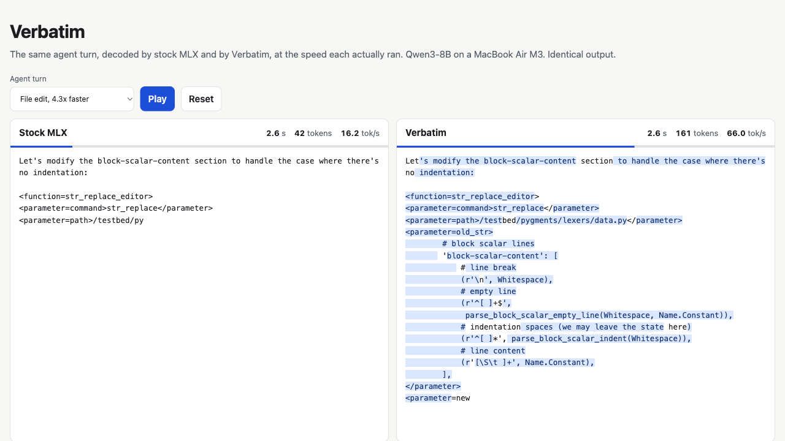
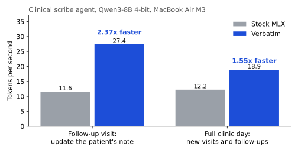
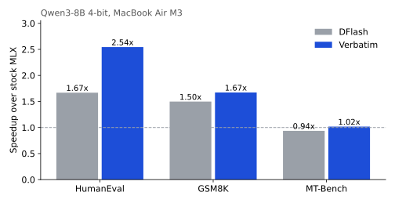
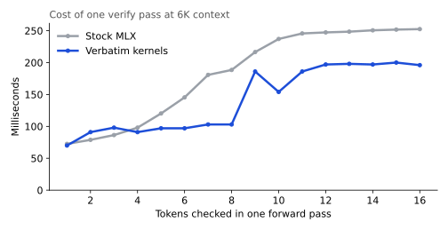
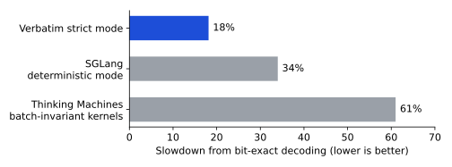
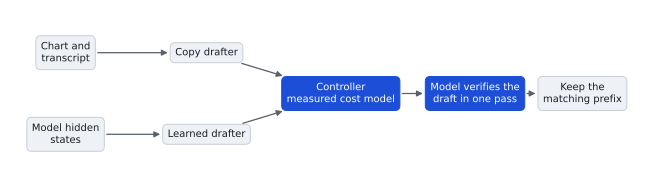

# Verbatim

Lossless inference acceleration for private clinical AI.

Verbatim makes a self-hosted model write clinical notes up to **3.4x faster**, with output that is **bit-identical** to the model running without it. It runs on the hardware you already own, keeps patient data on it, and never changes a word of a validated model's output.

Demo: [https://youtu.be/SBwXjz12r_U](https://youtu.be/SBwXjz12r_U)



*An autonomous scribe updating a patient's note after a follow-up visit, on a fanless MacBook Air M3 with Qwen3-8B, replayed at recorded speed. Blue text was carried over from the chart or transcript and verified by the model in bulk.*

## Highlights

Qwen3-8B 4-bit on a MacBook Air M3 (16 GB, fanless), against stock MLX.

- **2.37x faster on follow-up visits**, where the agent updates the patient's existing note: 27.4 tok/s against 11.6.
- **Up to 3.4x faster** on a single patient visit.
- **1.55x faster across a full clinic day** of new visits and follow-ups.
- **16 of 16 notes bit-identical** to plain decoding.
- **3.7% cost for bit-exact decoding**, against 34% for SGLang and 61% for batch-invariant kernels from Thinking Machines.
- **6 GB of memory** for an 8B model. A laptop runs it fully offline.



## Why clinical notes

Most of a clinical note already exists somewhere. In a study of 23,630 signed progress notes, 46% of the text was copied and 36% imported, and only 18% was typed fresh ([JAMA Internal Medicine](https://jamanetwork.com/journals/jamainternalmedicine/article-abstract/2629493)). A documentation agent works the same way. At each visit it carries the history, medications and problem list forward, quotes the exam and the patient, and changes what changed.

Language models write one token per forward pass no matter how predictable the text is. Verbatim finds the passages the agent is about to carry over, and the model checks a whole passage in a single pass.

Every output is bit-identical to the model without Verbatim. Speeding up a model usually changes what it writes. Verbatim leaves the output untouched: the notes you validated are the notes you ship, and any note can be replayed exactly for audit. FDA guidance on changes to AI-enabled devices calls for reproducible model performance.

## The benchmark

The workload comes from [ACI-Bench](https://github.com/wyim/aci-bench) (CC BY 4.0), a set of doctor-patient conversations with clinician-written notes.

| Task | What the agent does | Prompts |
|---|---|---|
| **New visit** | Writes the note from the visit transcript | 8 |
| **Follow-up visit** | Reads the patient's current note and a follow-up transcript, then writes the complete updated note | 8 |

ACI-Bench has no repeat visits, so Qwen3-8B wrote a six-week follow-up conversation for each patient. Each conversation includes a dose change, a new complaint and new exam findings. Stock MLX and Verbatim alternate prompt by prompt on the same laptop, so both run under the same conditions. Outputs run to 768 tokens.

## Faster than the frontier

**Wall-clock speed against DFlash.** DFlash is a state-of-the-art block-diffusion drafter with an official Qwen3-8B release. Verbatim beats it on every benchmark on the same machine, with every output bit-identical.



**Cheaper verification.** Checking 8 tokens costs Verbatim 103 ms and stock MLX 188 ms. Cheap checks are what turn a good draft into real speed.



**Exact output, nearly free.** Bit-exact inference usually costs a third or more of throughput. Verbatim's strict kernels cost under 4%.



## How it works



1. **Copy drafter.** Indexes everything in the agent's context, including the prior note, the transcript and the agent's own output, and drafts the exact tokens the model is about to carry over, up to 15 per pass. It needs no training and works with any model.
2. **Learned drafter.** For new text, DFlash proposes a block of tokens from the model's hidden states.
3. **Controller.** Each step takes the cheapest path among a copy draft, a learned draft, recycled tokens and a plain step, using verify costs measured on the actual hardware.
4. **Fast verify kernels.** A tile-major 4-bit weight layout, fused inputs and a 64-key attention block nearly halve the cost of checking a draft.
5. **Exact kernels.** Custom Metal kernels for 4-bit matmul and attention compute every row the same way whether the model processes 1 token or 16. A verify pass and a plain decode step agree bit for bit, so speculation never changes the output.

## Run the demo

```bash
cd demo && python3 -m http.server
```

Open `http://localhost:8000`, pick a patient visit and press Play. Both panes replay the per-pass timings recorded on the M3.

## Reproduce

Hardware: MacBook Air M3, 16 GB, macOS 26.6.

```bash
uv venv --python 3.12 .venv-dflash
uv pip install --python .venv-dflash/bin/python mlx mlx-lm dflash pyarrow transformers matplotlib
.venv-dflash/bin/hf download mlx-community/Qwen3-8B-4bit --local-dir models/mlx-qwen3-8b-4bit
.venv-dflash/bin/hf download z-lab/Qwen3-8B-DFlash-b16 --local-dir models/dflash-qwen3-8b
mkdir -p ds/aci && for f in valid clinicalnlp_taskB_test1; do
  curl -sLo ds/aci/$f.csv https://raw.githubusercontent.com/wyim/aci-bench/main/data/challenge_data/$f.csv; done

.venv-dflash/bin/python tests/test_strict_kernels.py
.venv-dflash/bin/python scripts/build_clinical.py
for i in $(seq 0 15); do
  .venv-dflash/bin/python scripts/dflash_bench.py --stock --datasets clinical --n 16 --only $i --max-tokens 768 \
      --configs base --out results/clinical_stock.jsonl
  .venv-dflash/bin/python scripts/dflash_bench.py --datasets clinical --n 16 --only $i --max-tokens 768 \
      --configs sbase,sadaptrdwc,sverbr --out results/clinical_verbatim.jsonl
done
.venv-dflash/bin/python scripts/build_demo.py results/clinical_stock.jsonl results/clinical_verbatim.jsonl
.venv-dflash/bin/python scripts/figures.py
```

## Layout

| Path | Contents |
|---|---|
| `verbatim/` | Copy drafter, speculative decode loop, Metal kernels |
| `scripts/` | Workload builder, benchmark, demo and figure builders |
| `data/` | Clinical workload and measured hardware cost curves |
| `results/` | Raw benchmark output behind every number above |
| `demo/` | Side-by-side replay page |
| `tests/` | Drafter and kernel equivalence tests |

## Next

Longitudinal patient summaries across many visits, pre-charting from the full record, and multi-patient serving on a single workstation GPU.
