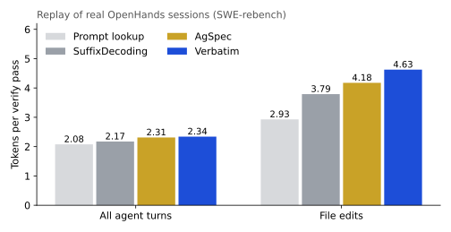
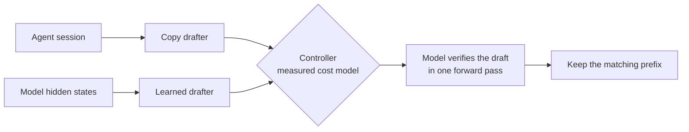

# Verbatim

Lossless decode acceleration for AI coding agents, running on a laptop.

Verbatim makes a language model write up to **4.3x faster** with output that is **bit-identical** to normal decoding. It predicts the tokens an agent is about to write, mostly text the agent already read, and the model checks the whole guess in a single forward pass.


*The same SWE-bench agent turn on a fanless MacBook Air M3, replayed at recorded speed. Stock MLX: 16 tok/s. Verbatim: 66 tok/s. Blue text was copied from the session and verified by the model.*

## Highlights

All results use Qwen3-8B 4-bit on a MacBook Air M3 (16 GB, fanless) with MLX.

- **4.3x faster** on a real agent file edit, and **1.73x** on average across file-edit turns.
- **2.54x faster on HumanEval**, against 1.67x for DFlash, a state-of-the-art block-diffusion drafter.
- **More tokens per pass than SuffixDecoding and AgSpec** on real agent sessions: 4.63 per pass on file edits.
- **Bit-identical output** on every prompt tested: 12 of 12 agent turns and 20 of 20 benchmark prompts.
- **18% cost for bit-exact decoding**, against 34% for SGLang and 61% for batch-invariant kernels from Thinking Machines. Speculation more than wins it back.

## Faster than the frontier

**Wall-clock speed against DFlash.** DFlash is a state-of-the-art block-diffusion drafter with an official Qwen3-8B release. Verbatim beats it on every workload on the same machine, and every Verbatim output is bit-identical to plain decoding.


**Drafting accuracy against the agent-specific methods.** Each drafter replays 10 real OpenHands sessions from SWE-rebench. More tokens accepted per verify pass means fewer passes for the same output. Verbatim leads overall, and its lead grows on file edits, where agents spend most of their output.



**Cheaper verification.** Speculation pays off when checking many tokens costs about the same as producing one. Verbatim's kernels check 8 tokens in 103 ms, while stock MLX takes 188 ms.


**Exact output at low cost.** Bit-exact inference usually means slower inference. Verbatim's strict kernels cost about half as much as the next best published approach.


## How it works



1. **Copy drafter.** Agents re-type text they have read: file views, diffs, tool arguments. Verbatim indexes the whole session, including line-number-stripped, diff-prefixed, JSON-escaped and re-indented forms of every line. It drafts up to 15 exact tokens per pass, with no training, on any model.
2. **Learned drafter.** When there is nothing to copy, DFlash proposes a block of tokens from the model's hidden states.
3. **Controller.** Each step takes the cheapest path among a copy draft, a learned draft, recycled tokens and a plain step. It decides using verify costs measured on the actual hardware.
4. **Fast verify kernels.** A tile-major 4-bit weight layout, fused inputs and a 64-key attention block nearly halve the cost of checking a draft. One copy of the weights stays in memory: 6 GB for an 8B model.
5. **Exact kernels.** Custom Metal kernels for 4-bit matmul and attention compute every row the same way whether the model processes 1 token or 16. A verify pass and a plain decode step therefore agree bit for bit, so speculation never changes the output.

## Run the demo

```bash
cd demo && python3 -m http.server
```

Open `http://localhost:8000`, pick an agent turn and press Play. Both panes replay the per-pass timings recorded on the M3.

## Reproduce

Hardware: MacBook Air M3, 16 GB, macOS 26.6.

```bash
uv venv --python 3.12 .venv-dflash
uv pip install --python .venv-dflash/bin/python mlx mlx-lm dflash pyarrow transformers matplotlib
.venv-dflash/bin/hf download mlx-community/Qwen3-8B-4bit --local-dir models/mlx-qwen3-8b-4bit
.venv-dflash/bin/hf download z-lab/Qwen3-8B-DFlash-b16 --local-dir models/dflash-qwen3-8b

.venv-dflash/bin/python tests/test_strict_kernels.py
.venv-dflash/bin/python scripts/dflash_bench.py --stock --datasets agent --n 12 --configs base --out results/demo_stock.jsonl
.venv-dflash/bin/python scripts/dflash_bench.py --datasets agent --n 12 --configs sbase,sadaptrdwc,sverbr --out results/demo_verbatim.jsonl
.venv-dflash/bin/python scripts/build_demo.py results/demo_stock.jsonl results/demo_verbatim.jsonl
.venv-dflash/bin/python scripts/figures.py
```

The drafter comparison runs on CPU from a shard of SWE-rebench trajectories, with `llama-cpp-python` and the Qwen2.5-Coder 7B GGUF for tokenization:

```bash
python scripts/simulate.py ds/nebius/rg0_400.parquet --format openhands --trajs 10 \
    --configs verbatim,suffix,agspec-forms,pld --cost data/cost_h100_roofline.json --out results/sim_frontier.jsonl
```

## Layout

| Path | Contents |
|---|---|
| `verbatim/` | Copy drafter, speculative decode loop, Metal kernels |
| `scripts/` | Benchmarks, drafter simulator, demo and figure builders |
| `results/` | Raw benchmark output behind every number above |
| `demo/` | Side-by-side replay page |
| `tests/` | Drafter and kernel equivalence tests |

## Data

- [SWE-bench/SWE-smith-trajectories](https://huggingface.co/datasets/SWE-bench/SWE-smith-trajectories), MIT. Agent turns for the wall-clock benchmark.
- [nebius/SWE-rebench-openhands-trajectories](https://huggingface.co/datasets/nebius/SWE-rebench-openhands-trajectories), CC-BY-4.0. Sessions for the drafter comparison.

## Next

A drafter fine-tuned on long agent trajectories to cover text that appears nowhere in the session, then a head-to-head on an H100 against SuffixDecoding, AgSpec, EAGLE-3 and DFlash on the same agent sessions.
